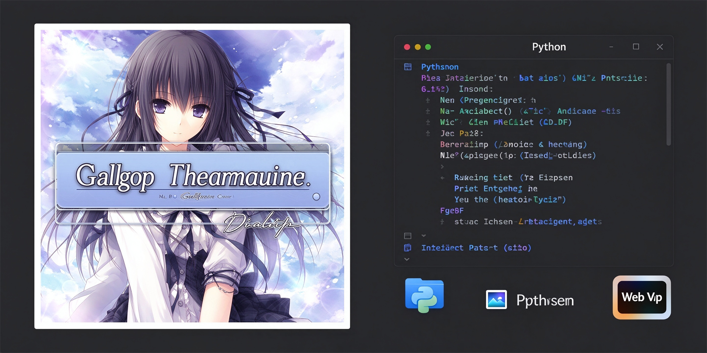

# Galgame Cover Watermark



**Galgame 封面标题监控器**是一款面向 Windows 的桌面小工具，用于给 Galgame 封面图片添加居中的游戏标题，并将成品统一保存为 WebP。程序支持系统托盘后台运行，可选择手动逐张确认，也可开启自动加水印。

- **开发者：** 码铃薯
- **官网：** https://www.tudoucode.cn
- **技术栈：** Python、PySide6、Pillow
- **仓库名称：** `Galgame-Cover-Watermark`

## ✨ 功能特性

- **游戏名称必填：** 游戏标题位于主界面顶部。未填写标题时不能启动监控或添加水印。
- **手动 / 自动模式：** 默认手动确认每张新图片；开启自动模式后，程序使用处理该图片时输入框中的当前标题。不同游戏请及时修改标题。
- **图片自动监控：** 监控所选文件夹第一层中名称恰好为 `0` 的图片，例如 `0.jpg`、`0.png`、`0.avif`。监控开始时已有的图片仅作为基线，不会立即处理；后续新增或发生变化的目标图片才会进入队列。
- **常见图片格式输入：** 包括 JPG、JPEG、PNG、WebP、AVIF、HEIC/HEIF、BMP、GIF、TIFF、ICO 等 Pillow 支持的栅格格式。AVIF、HEIC/HEIF 的解码能力取决于 Pillow 版本及 `pillow-heif` 插件。
- **统一输出 WebP：** 标题水平和垂直居中，支持调节标题最大宽度、文字颜色、阴影强度、描边强度及 WebP 输出质量。
- **防止重复加水印：** 按文件内容哈希记录原图及成品。识别到完全相同的历史图片时会跳过处理并改名保留，不会再次叠加标题。
- **记忆管理：** 可在界面中清空防重复记忆，允许干净原图重新处理。清空记忆不会删除已生成的 WebP 文件。
- **Windows 系统托盘：** 使用 PySide6 的 `QSystemTrayIcon`。最小化或关闭主窗口时隐藏到托盘；可通过托盘菜单恢复主界面、开始/停止监控、清空记忆或彻底退出。
- **适配小屏幕：** 主界面支持滚动查看设置、待处理图片、预览和日志。
- **记住设置：** 程序会保存游戏名称、监控目录及样式设置，方便下次继续使用。

## ⚠️ 重要说明

> **成功加水印后，程序会删除原始图片。** 输出 WebP 保存成功、内容检查通过且防重复记忆保存成功后，才会删除原图。请先使用可恢复的测试图片验证工作流程，并提前备份重要文件。

- 目标文件的主文件名必须恰好为 `0`，例如 `0.jpg`；`cover0.jpg` 不会被监控。
- 程序只监控所选文件夹的第一层，不递归扫描子文件夹。
- 动画 GIF、APNG、WebP 等默认只读取第一帧。
- 自动模式使用处理开始时的当前标题。若每张图片都需要不同标题，建议使用手动模式，或者在每张新图片进入处理前更新标题。
- 防重复记录和设置保存在当前 Windows 用户的本地应用数据目录：`%LOCALAPPDATA%\GalgameCoverTitleWatcher\`。
- 清空防重复记忆不会恢复已删除的原图，也不会删除现有成品。重新处理时请使用干净的原图，避免重复叠加水印。

## 💻 运行环境

- Windows 10 / Windows 11
- Python 3.10 或更高版本（从源码运行或自行打包时需要）
- 依赖：PySide6、Pillow、pillow-heif

## 🚀 从源码运行

在项目目录打开命令提示符，执行：

```cmd
python -m pip install --upgrade PySide6 pillow pillow-heif
python galgame_cover_title_watcher.py
```

如果当前 Pillow 已能原生解码某种图片格式，可无需额外格式插件；对于 AVIF、HEIC/HEIF，如遇解码错误，请先更新 Pillow 与 `pillow-heif`。

## 📦 打包为 Windows EXE

安装打包工具：

```cmd
python -m pip install --upgrade PyInstaller
```

在 `galgame_cover_title_watcher.py` 所在目录执行：

```cmd
python -m PyInstaller --noconfirm --clean --onefile --windowed --name "Galgame封面标题监控器" --collect-all PIL --collect-all pillow_heif galgame_cover_title_watcher.py
```

打包完成后，EXE 位于：

```text
dist\Galgame封面标题监控器.exe
```

> 请使用 Windows 环境打包 Windows EXE。首次运行时，如果系统托盘图标未显示，请先检查任务栏右侧的 `^` 隐藏图标区域，并确认 Windows 通知区域允许显示应用图标。

## 📝 使用步骤

1. 启动程序，在窗口顶部填写游戏名称。
2. 选择要监控的文件夹。
3. 调整标题宽度、颜色、阴影、描边和 WebP 质量。
4. 点击「开始监控」。监控启动前已经存在的目标图片不会立即处理。
5. 将新的 `0.jpg`、`0.png`、`0.webp`、`0.avif` 等图片放入监控目录。
6. 手动模式下，选择待处理图片并点击「确认加水印并替换原图」；自动模式下，程序将使用当前标题自动处理。
7. 成品会保存为同目录中的 `0_已加水印.webp`；若该名称已存在，程序会自动生成不冲突的文件名。
8. 点击窗口最小化或关闭时，程序会尽可能隐藏到系统托盘。右键托盘图标可恢复界面或选择「彻底退出后台程序」。

## 📥 发布下载

Windows 预编译版发布后，可从本仓库的 **Releases** 页面下载。仓库创建并发布第一个 Release 后，可在此处补充固定的下载链接。

## 👨‍💻 开发者

**码铃薯**

官网：[www.tudoucode.cn](https://www.tudoucode.cn)

## 🐛 反馈与问题排查

反馈问题时，请尽量附上：

- Windows 版本和 Python 版本（如果从源码运行）
- 程序日志中的错误信息
- 出问题的图片格式及扩展名
- 执行过的完整命令（如果是打包问题）

请勿上传包含个人隐私或不便公开的图片。
